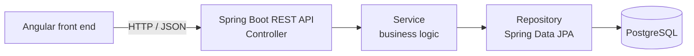

# Tutorials Management Web App

A **tutorials management web application** for an e-learning site, built during a six-week internship at **Be-Softilys** (Tunisia), July to August 2024.

This repository holds the **internship documentation**: the full project report, with analysis, design and implementation details.

## The project

Popular learning sites such as W3Schools or BezKoder offer a lot of content, but quality varies and many features are paid. The goal here was a simpler system that **centralises tutorials** and makes them easy to find and manage.

| Role | What they can do |
|---|---|
| **Administrator** | Add, edit and delete tutorials |
| **Student** | Browse and search tutorials, build a personal list, manage their account |

## Architecture

The back end follows the **MVC** approach and a layered Spring Boot structure.

| Layer | Responsibility |
|---|---|
| **Controller** | REST endpoints for creating, reading, updating and deleting tutorials |
| **Service** | Business logic behind each CRUD operation |
| **Repository** | Data access through Spring Data JPA (`JpaRepository`) |
| **Model** | JPA entities mapped to the database tables |

The API was tested with **Postman**. The front end is an **Angular 16** CRUD application that consumes the API.

## What I did

- Analysed existing solutions and wrote the use cases for each type of user.
- Built the **Spring Boot REST API** with the full CRUD cycle and a PostgreSQL database.
- Built the **Angular front end** for the administrator and student interfaces.
- Delivered the application iteratively, finishing each feature before starting the next.

## Skills shown

Java · Spring Boot · Spring Data JPA · REST API design · PostgreSQL · Angular · MVC architecture · API testing with Postman · UML use cases

## Repository content

| File | Content |
|---|---|
| `Rapport de stage -Rania Ben Hmida.pdf` | Internship report (29 pages, in French): company and project context, requirements analysis, back-end and front-end implementation, conclusion |

## Author

**Rania Ben Hmida**, Data & AI Engineer · [LinkedIn](https://www.linkedin.com/in/rania-ben-hmida-586724291/) · [GitHub](https://github.com/Rania-BenHmida)
